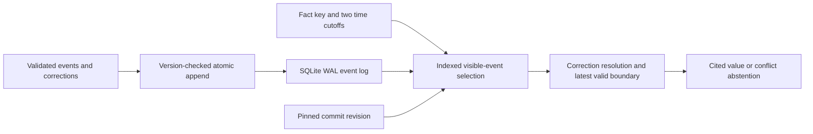

# Temporal RAG

<!-- at-a-glance -->
[](https://github.com/pavan139/temporal-rag/actions/workflows/ci.yml) 

| | |
| --- | --- |
| **Problem** | RAG over facts that change returns the right sentence from the wrong point in time. |
| **Result** | Recovered **19/19** exact source sets vs **11/19** for a lexical + recency baseline (synthetic facts). |
| **Try it** | `pip install -e .` then `python -m temporal_rag evaluate --output artifacts/fixture-evaluation.json` |
<!-- /at-a-glance -->


Who owned Atlas on February 15? The answer can change when the question is asked with a later knowledge cutoff:

```python
from temporal_rag import TemporalRetriever
from temporal_rag.data import generate_events

facts = TemporalRetriever(generate_events())
earlier = facts.query("atlas", "owner",
    as_of="2025-02-15T00:00:00Z", known_at="2025-02-15T00:00:00Z")
corrected = facts.query("atlas", "owner",
    as_of="2025-02-15T00:00:00Z", known_at="2025-03-15T00:00:00Z")
print(earlier["value"], earlier["citations"])     # Ben ['a2']
print(corrected["value"], corrected["citations"]) # Cora ['a3']
```

The correction does not rewrite the older knowledge snapshot. This retriever separates when a fact applies, when it was recorded, and which committed corpus revision a reader sees. Conflicting active facts at the latest valid boundary produce an abstention with provenance.

## Query the event log

Python 3.11+ and SQLite 3.35+ support the persistent path. Use a fresh database for the import example:

```bash
python -m pip install -e .
python -m temporal_rag store-import --database artifacts/memory.sqlite --events walkthrough/events.json --expected-version 0
python -m temporal_rag store-query --database artifacts/memory.sqlite --entity atlas --attribute owner --as-of 2025-02-15T00:00:00Z --known-at 2025-04-15T00:00:00Z --version 1
```

Appends are immutable and compare the caller's expected commit version under the writer transaction. A stale version fails before insertion. A read snapshot can stay pinned while another connection commits a correction. Existing event IDs cannot be overwritten or deleted through the store.



## What the measurements establish

The small fixture contains 13 events and 19 independently labeled cases. Timestamp-aware retrieval recovered the exact source set in 19/19 cases; a lexical-plus-recency baseline recovered 11/19. Those are structured synthetic facts scored with a deterministic answerer.

The larger storage experiment compared 128 indexed queries over 11,497 events with an independent Python scan and found zero source-ID mismatches. [The report](reports/storage-benchmark.json) includes actual query plans, VM-step estimates, append work and local timings. It avoids scanning unrelated fact keys; it still processes the eligible history for the requested key.

```bash
python -m temporal_rag evaluate --output artifacts/fixture-evaluation.json
python -m temporal_rag store-benchmark --entities 128 --versions 64 --queries 128 --output artifacts/storage.json
```

The optional `hf-evaluate` command accepts an existing local safetensors checkpoint and validates generated JSON against retrieved evidence. Its recorded status is [not run](walkthrough/hf-status.json), with zero generation calls. The reference results do not measure generated-answer quality.

## Time and trust boundaries

Both time cutoffs are inclusive, timezone aware UTC microseconds. A correction must target the same entity, attribute and effective boundary at a strictly later recording time. Divergent visible corrections remain conflicting evidence rather than being settled by recording recency.

Structured metadata is application-owned. Retrieved document text cannot change these rules or grant capabilities. Citation checks establish support in the supplied context, not external truth or the completeness of that context. Availability timestamps are supplied provenance. Long-held WAL readers can retain pages; the store has no retention service, source authentication or tenant ACL layer.

## Files worth reading

```text
src/temporal_rag/retrieval.py     In-memory selection and answer contracts
src/temporal_rag/sqlite_store.py Indexed storage and snapshots
src/temporal_rag/storage_benchmark.py Independent scan comparison
design/                         Temporal rules and storage notes
policies/                       Documented fixed CLI defaults
walkthrough/                    Synthetic event log and explained responses
test/                           Time boundaries, corrections and concurrent readers
tools/check_retrieval.py         Package verification entry point
```

Start with [the bitemporal layout](design/bitemporal-layout.md), then [the indexed algorithm](design/interval-index.md). [Query reference](design/query-reference.md) contains the complete API, generation budgets and import limits.

```bash
python -m pip install -e . -r requirements-dev.txt
RUN_ML_SMOKE=1 PYTHONPATH=src python -m unittest discover -s test -v
python tools/check_retrieval.py --require-lint --wheel
```

The recorded suite has 58 tests. [Reproduction notes](design/reproducing-the-retriever.md) link the software-check artifact; [sharing the event log](design/sharing-the-event-log.md) describes what belongs in a release.
