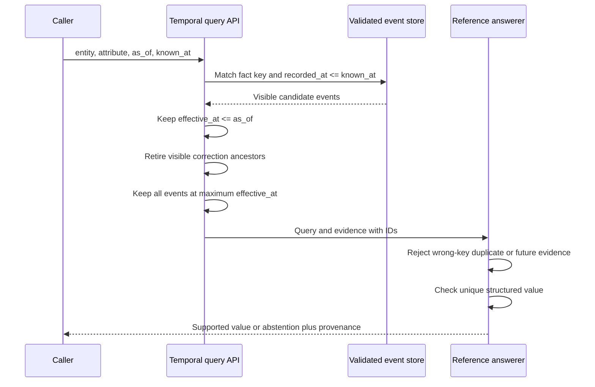

# Architecture and temporal contract

## Data flow

## Contracts

`Event` stores `id`, `entity`, `attribute`, `value`, `effective_at`, `recorded_at`, `text`, `source_uri`, and optional `corrects`. IDs are stable and unique. Limits are enforced at ingestion before query processing. Timestamp strings must include a timezone and normalize to UTC. An announced future event is valid: its effective time can be later than its recorded time.

`Query` contains a fact key and two explicit timestamps. An omitted cutoff in the convenience API uses the same captured UTC instant for current queries. Queries never infer dates from natural language. Optional query text influences the lexical baseline only.

`ReferenceAnswerer` returns an answerer identity, status (`answered` or `abstained`), reason, structured value, citations, cutoffs, and provenance. Unknown facts yield no value or citations. Conflicts yield no value and cite the conflicting facts. Multiple independent sources with the same structured value can support an answer.

The reference and local-generation boundaries independently validate evidence types, unique IDs, matching keys, `recorded_at <= known_at`, and `effective_at <= as_of`. A retriever returning future context therefore causes an explicit error rather than a citation-valid future answer. The evaluator retains that as a rejected-context failure and continues. These local checks cannot infer an omitted newer event from a partial context.

## Retrieval algorithm

1. Filter on entity, attribute, and `recorded_at <= known_at` to prevent future-knowledge leakage.
2. Keep events with `effective_at <= as_of`.
3. Remove every event named by a visible eligible correction. Strictly increasing recording times make correction cycles invalid. Correction chains retire all earlier links; divergent corrections remain independent and can conflict.
4. Retain all remaining events at the greatest effective timestamp. Later recording time is not a conflict-resolution authority.
5. Preserve all evidence at that boundary so answering can abstain on conflicting values.

The in-memory reference scans at most 5,000 events per query. Source URI and original timestamps remain attached to the evidence. The new `SQLiteTemporalStore` implements persistent indexed retrieval, transactional CAS append, and pinned WAL snapshots; see [interval-index.md](interval-index.md) for its separate storage contract and complexity. Neither path implements deletion of immutable history.

`TemporalRetriever.explain(query)` shares the selection implementation with retrieval. It classifies visible candidates as selected, not yet effective, superseded by a visible correction, or older than the selected boundary. Unpublished event IDs and values never enter the explanation. The `query --explain` CLI exposes this audit for arbitrary imported fact keys and explicit cutoffs.

## Trust and generation boundary

Structured metadata is an input contract for an application-owned event log. The code validates schema and relations, not external factual truth or source authenticity. Raw text is untrusted and cannot modify control flow. A poisoned text fixture verifies this separation for the deterministic reference path; it does not measure LLM prompt-injection resistance.

The optional `LocalHFAnswerer` receives only `Query` and retrieved `Event` evidence. It constructs a bounded prompt with JSON evidence and no evaluation labels. It lazily loads an explicit existing local checkpoint through Transformers with local-files-only, remote-code-disabled, safetensors-only flags, then performs CPU causal generation. Input defaults are 6,000 evidence characters and 512 tokens; generation defaults to 128 new tokens. It refuses oversize input instead of truncating away evidence. Token limits do not bound model-weight memory or wall-clock time.

Model output must be a single JSON object with exactly `status`, `value`, and `citations`. Duplicate JSON keys, malformed JSON, extra fields, unsupported values, invented/duplicate citation IDs, and answers that cherry-pick conflicting evidence are rejected. Missing and conflicting evidence produce a separately labeled host-policy abstention before model loading. Generation failures never substitute deterministic success text. `validate_answer` checks citation existence, duplicates, supported structured values, and conflicting context. It cannot prove free-form semantic faithfulness; the output contract intentionally uses a structured value rather than arbitrary explanatory prose.

The `hf-evaluate` evaluator owns labels and passes none to the answerer. It runs the same 19 cases, records generated-answer failures separately from retrieval, and reports checkpoint path, config hash, library versions when loaded, CPU and token budgets, request usage/latency, executed status, and actual model-call count. A missing checkpoint or missing optional dependency yields `not_run` with zero calls. The checked-in HF status is explicitly unrun; no weights were loaded during project verification.

## Failure behavior and observability

`TemporalError.code` distinguishes invalid input, timestamp, event, correction, duplicate ID, budget, context, citation, and unsupported-answer errors. File-system errors remain `io_error` at the CLI. Errors are returned with a nonzero exit status; no canned answer substitutes for failure.

Reports contain the synthetic dataset name/hash, case count, answerer version, zero live-model call count, independent retrieval/answer denominators, per-case results, and failed case IDs. Provenance can contain the original imported text; no redaction or retention service is provided. Do not ingest secrets. Artifacts stay local and are git-ignored by default.

Reference evaluation also reports per-tag slices and rejected-context counts. Citation membership denominators contain only produced answers; rejected contexts are not silently counted as valid answers or abstentions. Extreme ISO timestamps that overflow UTC conversion and duplicate JSON import keys fail with stable input errors.

## Verification and limits

Unit tests cover correction chains and divergent branches, inclusive cutoffs, timezone conversion, late recording, duplicate/malformed/oversized inputs, same-value corroboration, fabricated citations, unsupported values, conflicting evidence, and untrusted text. The offline evaluation uses 19 hand-labeled synthetic cases and reports the intentionally limited lexical/latest baseline separately.

The default benchmark is a deterministic contract test set, not held-out evidence of generalization. The optional local model adapter has parser, citation, budget, no-label, missing-checkpoint, and no-import tests; actual checkpoint loading and inference remain untested. The persistent path adds a durable local store and concurrency tests; no vector model, tenant ACL, authenticated source ingest, distributed concurrency service, or production-readiness assertion is made. Its executed independent-oracle benchmark and remaining limits are recorded in [asof-index-results.md](asof-index-results.md).
