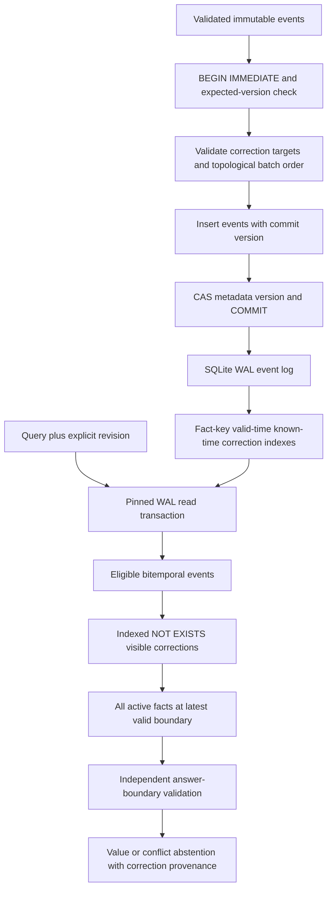

# Persistent bitemporal memory: design and algorithms

The storage implementation is in `sqlite_store.py`. It adds durable indexed retrieval and concurrency semantics to the in-memory reference model; it does not infer temporal truth from natural-language documents.

## Three different time axes

1. `effective_at`: when the fact applies in the described world.
2. `recorded_at`: when the source says the fact became known.
3. `commit_version`: when the application actually appended its transaction.

The first two use exact signed integer UTC microseconds, avoiding floating epoch conversion. A query includes inclusive `as_of` and `known_at` cutoffs. A snapshot additionally pins a committed corpus revision. Thus a newly imported backdated record cannot change the result of an old explicit revision, even if its claimed `recorded_at` is earlier.

## Immutable append and optimistic concurrency

`append(events, expected_version=v)` accepts at most 1,000 validated events. It begins `BEGIN IMMEDIATE`, reads metadata under SQLite's serialized writer lock, and rejects a stale expected version before any insert. It checks all correction references against the same transaction, sorts a batch by recording time so references precede children, inserts every event with version `v+1`, and performs a conditional metadata update. Any failure rolls back the whole batch.

SQLite serializes physical writers; the version check supplies optimistic application-level lost-update protection. Four clients reading version zero therefore produce one successful version-one commit and three `stale_version` outcomes. This is a local database guarantee, not a distributed exactly-once protocol. Duplicate IDs fail explicitly rather than guessing whether a caller retry is idempotent.

Foreign keys preserve references. Database triggers reject event updates/deletes, including direct SQL attempts through the connection. Full synchronous WAL commits are enabled. The database file remains application-owned: an actor able to drop triggers or replace the file is outside this API's authorization boundary.

## Indexed selection and correction semantics

The main statement materializes only the requested fact key's events satisfying both timestamp cutoffs and the selected commit version. An indexed anti-join removes any event targeted by a correction visible at the same snapshot. Correction validation requires the same entity, attribute, and effective boundary plus a strictly later recording timestamp. Therefore:

- A visible correction's parent is also known; it cannot create a temporal cycle.
- A chain retires all visible ancestors, even when an intermediate correction is itself superseded.
- A later-known correction never rewrites an earlier knowledge snapshot.
- Divergent corrections remain independent active facts; differing values cause abstention.
- Later effective boundaries supersede older ones, including previously announced future handoffs once they become effective.

The final selection retains **all** active events at the greatest eligible effective timestamp. It does not silently choose the most recently recorded conflicting source.

Indexes cover `(entity, attribute, effective_us, recorded_us, commit_version)`, `(entity, attribute, recorded_us, commit_version)`, and `(corrects, recorded_us, commit_version)`. SQLite chooses the fact-key index using its planner; `query_plan` exposes the actual plan. This is not an O(log N)-only interval tree: with H eligible events for one key, materialization and conflict resolution still cost approximately O(H), plus correction index probes. It avoids scanning unrelated entities in the N-event log.

## Consistent snapshots and answer integration

`with store.snapshot(version=None) as snapshot` begins a read transaction and reads the metadata version immediately, pinning the WAL snapshot. Multiple reads through that handle observe one revision while another connection commits. An optional earlier revision adds `commit_version <= revision` to every selection and provenance lookup. A handle becomes unusable after its context exits.

`snapshot.answer(query)` passes selected immutable events to the existing reference answerer, whose independent cutoff/citation checks remain active. It adds the snapshot version, query work, and original-to-current correction chains. Provenance lookup validates that its starting event really belongs to the selected snapshot; arbitrary or future event objects are rejected. A bounded chain depth fails explicitly rather than truncating evidence.

## Resource model and measurements

- Up to one million stored events; 1,000 events per append; one connection per instance/thread.
- Read VM work defaults to an approximately two-million-instruction limit, interruptible via SQLite's progress handler every 100 instructions. It is not a wall-clock deadline.
- Work reports distinguish progress-handler VM estimates, exact returned-row counts, correction-target lookups, transaction time, SQL execute/fetch time, and total retrieval time including Event validation.
- VM estimates, Python records examined, disk reads, and FLOPs are different units. No conversion between them is invented.
- Long-lived WAL readers can retain WAL pages and delay checkpoint reclamation. The library does not provide a reader lease service, backups, schema migration framework, source authentication, or tenant ACLs.

## Independent verification

The seeded storage benchmark creates more than 11,000 events, including late arrivals, future announcements, chains, and divergent corrections. An independent Python scan groups visible active events by boundary; it does not call the SQL store or the in-memory retriever. Results are compared by exact source IDs for every query. Reports retain cutoffs, per-query work, query plans, failures, and update transactions. A nonzero mismatch count makes the benchmark CLI fail.
