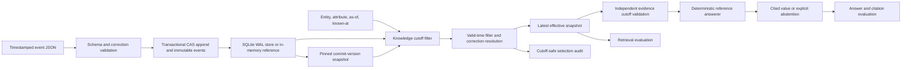

# Temporal RAG: replay facts without rewriting history

An ownership handoff can be announced before it takes effect, recorded late, or corrected after publication. This project retrieves the fact valid at a requested time **using only information known by a separate knowledge cutoff**. It preserves citation IDs and correction provenance, and abstains when the current snapshot contains contradictory facts.

The persistent core provides **SQLite WAL storage, indexed bitemporal selection, immutable events, optimistic versioned writes, and pinned read snapshots**. It is compared against an independent scan oracle on more than 11,000 seeded events. The small in-memory fixture remains available for learning and regression checks.

The default vertical slice uses structured synthetic events, lexical retrieval, and an explicitly labeled **deterministic reference answerer**. An optional Hugging Face adapter performs actual grounded generation from an existing local checkpoint. That adapter has not been run against weights in the checked-in results; no generated-answer accuracy is claimed.



## Run

Python 3.11+; the runtime and tests have no third-party dependencies.

```bash
python -m pip install -e .
python -m temporal_rag demo --output artifacts/demo.json
python -m temporal_rag evaluate --output artifacts/evaluation.json
python -m unittest discover -s test -v
```

The installed `temporal-rag` command supports the same arguments. `make test`, `make demo`, and `make evaluate` also work without installation using `PYTHONPATH=src`. JSON is printed to stdout; `--output` additionally writes a file. Invalid input emits a structured error to stderr and exits with status 2.

Import the provided fixture, or an array with the same schema:

```bash
python -m temporal_rag demo --events walkthrough/events.json
python -m temporal_rag query --events walkthrough/events.json --entity atlas --attribute owner \
  --as-of 2025-03-15T00:00:00Z --known-at 2025-04-15T00:00:00Z --explain \
  --output artifacts/explained-query.json
```

`query` supports arbitrary imported entity/attribute keys and explicit cutoffs. `--explain` shows why each visible candidate was selected, superseded, older, or not yet effective. Events recorded after `known_at` are omitted entirely from the audit, including their IDs. See [the executed explained query](../walkthrough/explained-query.json).

## Persistent indexed memory

SQLite 3.35+ is required for this path; no additional Python package is needed.

```bash
python -m temporal_rag store-import --database artifacts/memory.sqlite --events walkthrough/events.json --expected-version 0
python -m temporal_rag store-query --database artifacts/memory.sqlite --entity atlas --attribute owner \
  --as-of 2025-02-15T00:00:00Z --known-at 2025-04-15T00:00:00Z --version 1
python -m temporal_rag store-benchmark --entities 128 --versions 64 --queries 128 --output artifacts/storage-benchmark.json
```

Use a fresh database for the import example; repeating it with expected version zero correctly rejects a stale write. Batch appends are atomic and require the caller's expected version. Corrections append new records; database triggers reject updates and deletes. Two timestamps select the historical fact, while an optional commit revision pins the ingested corpus itself.

```python
from temporal_rag import Query, SQLiteTemporalStore

with SQLiteTemporalStore("artifacts/memory.sqlite") as store:
    with store.snapshot() as snapshot:
        # All reads here observe one WAL snapshot even if another connection commits.
        answer = snapshot.answer(Query("atlas", "owner", "2025-02-15T00:00:00Z", "2025-04-15T00:00:00Z"))
        print(answer["value"], answer["snapshot_version"], answer["correction_chains"])
```

The executed [storage benchmark](../reports/storage-benchmark.json) compares 128 queries over **11,497 events** against an independent Python scan with **zero source-ID mismatches**. Reports include per-query cutoffs, actual query plans, SQL VM-step estimates, returned rows, append work, and measured timings. These are local warm-cache observations, not a service latency guarantee. See [algorithm and concurrency design](interval-index.md) and [implementation evidence](asof-index-results.md).

## Optional actual local model evaluation

Supply an existing local causal-language-model checkpoint containing `config.json`, tokenizer files, and safetensors weights. Hub identifiers are not accepted as checkpoint locations. Installing the extra installs Python packages; the application never downloads models or enables checkpoint-provided Python code.

```bash
python -m pip install -e '.[hf]'
python -m temporal_rag hf-evaluate \
  --checkpoint /absolute/path/to/existing-local-checkpoint \
  --output artifacts/hf-evaluation.json
```

`LocalHFAnswerer` imports Transformers/Torch lazily, loads with `local_files_only=True`, `trust_remote_code=False`, and `use_safetensors=True`, and uses CPU inference. Defaults cap evidence at 6,000 characters, input at 512 tokens, and generation at 128 new tokens. Oversized context/input fails rather than silently dropping evidence. The selected model must fit your available CPU memory; token limits do not bound weight-loading memory or wall-clock latency.

The answerer receives only the query and retrieved `Event` evidence. It receives no expected values, source labels, or evaluation cases. The host independently rejects context recorded after `known_at`, effective after `as_of`, duplicated, or belonging to another fact before constructing the prompt. It requires exactly `{"status": "answered|abstained", "value": "supported value or null", "citations": ["retrieved-id"]}` as JSON. Markdown, duplicate keys, unexpected fields, invented citations, conflicting-context answers, and unsupported values fail validation. Missing/contradictory evidence triggers an explicitly labeled **host policy abstention with zero generation calls**. A generation or validation failure remains a failed case; it never falls back to a reference success.

`hf-evaluate` runs the same 19-case dataset and separates retrieval from actual generated-answer metrics. Reports identify the configured local checkpoint, config hash, provider, library versions when loaded, CPU/token budgets, model-call count, case failures, and execution status. Missing checkpoints or unavailable optional packages produce a `not_run` report and exit 2 before generation. [walkthrough/hf-status.json](../walkthrough/hf-status.json) records the current **not_run, zero-call** status; live checkpoint behavior and generated-answer quality remain untested. The unit tests exercise parsers and boundaries without importing ML libraries or loading weights.

## Query API

```python
from temporal_rag import TemporalRetriever
from temporal_rag.data import generate_events

engine = TemporalRetriever(generate_events())
original = engine.query("atlas", "owner",
    as_of="2025-02-15T00:00:00Z", known_at="2025-02-15T00:00:00Z")
corrected = engine.query("atlas", "owner",
    as_of="2025-02-15T00:00:00Z", known_at="2025-03-15T00:00:00Z")
print(original["value"], original["citations"])   # Ben ['a2']
print(corrected["value"], corrected["citations"]) # Cora ['a3']
current = engine.query("atlas", "owner")  # Both cutoffs use current UTC time.
```

`effective_at` describes when a fact applies; `recorded_at` describes when it became available. Both cutoffs are inclusive and timezone aware. `corrects` replaces an earlier event at the same entity/attribute/effective-time boundary and must have a strictly later recording timestamp. Independent conflicting values at the latest effective boundary cause `contradictory_context`; missing facts cause `missing_context`. Every response includes its cutoffs, source IDs, source URIs, timestamps, and correction links.

## Reproducible evaluation

The fixture has 13 synthetic events and 19 hand-labeled cases: historical/current queries, future announcements, late arrival, knowledge cutoffs, correction chains, exact/timezone boundaries, unknown facts, contradictory sources, and a malicious instruction inside document text. Expected source IDs are defined independently of retrieval. The seed changes ingestion order only.

Measured with `python -m temporal_rag evaluate`:

| System | Exact source sets | Macro recall on 16 nonempty cases | Reference answers correct | Correct abstentions | Rejected temporal contexts |
| --- | --- | --- | --- | --- | --- |
| Lexical overlap + latest recorded | 11/19 (57.9%) | 59.375% | 11/19 (57.9%) | 2/4 | 6/19 |
| Timestamp aware | 19/19 (100%) | 100% | 19/19 (100%) | 4/4 | 0/19 |

Dataset SHA-256: `a6db51ac2db2457d601968444b37dc1f4b05e9d2f7aa13138237982bfe2a7575`.

The baseline applies the same entity, attribute, and knowledge filters, then ranks by lexical overlap and recording recency. It lacks effective-time and correction handling. The answer boundary now rejects six baseline contexts that are not yet effective, records them as failures, and continues evaluating the remaining cases. Citation membership is valid on 13/13 produced baseline answers and 19/19 temporal answers; rejected contexts are counted separately. This deliberately small synthetic benchmark checks specified temporal behavior; its 100% reference score is not a real-world RAG or LLM quality estimate. [Full results](../walkthrough/evaluation.json) preserve each case, error, and per-tag slice denominator.

## Boundaries and extension work

- Input is limited to 5,000 events, a 10 MB import, 500 query characters, and bounded event fields. Naive timestamps, duplicate IDs, missing/cyclic correction references, and incompatible corrections are rejected.
- Entity/attribute metadata and structured values are application-owned records. Retrieved text is untrusted evidence; this implementation never executes it or interprets its instructions. This is a metadata-based retrieval lab, not extraction of trustworthy facts from arbitrary documents.
- Citation IDs, structured value support, and evidence time cutoffs are checked at the answer boundary. Those checks cannot establish external truth or prove that an incomplete supplied context contains the latest event. No prose-faithfulness claim is made. Queries have no external side effects, network calls, model tokens, or model charges. Raw imported context remains in exported provenance; use synthetic or authorized non-sensitive data.
- The persistent store caps total events at one million, appends at 1,000 events per transaction, and query VM work explicitly. Long-lived WAL readers can retain pages; reader leases and backup/retention services are outside scope. The in-memory reference still caps events at 5,000.
- Scope excludes tenant authorization, source authentication, deletion workflows, full-text ingestion, and a remote provider adapter. The optional local generation path still needs actual checkpoint evaluation before deployment.

See [design/bitemporal-layout.md](bitemporal-layout.md) for the event algorithm, contracts, and failure model. `policies/default.json` documents fixed CLI defaults; it is not an active runtime configuration loader.

The independent audit, reproduced defects, behavioral regressions, and verification limitations are recorded in [design/temporal-invariants.md](temporal-invariants.md).
